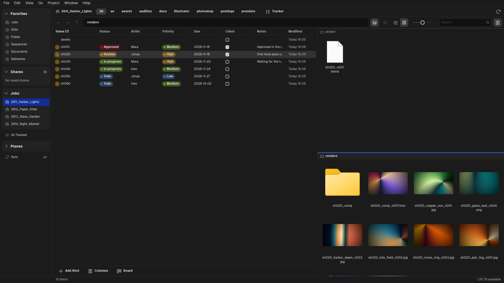

# UFB — Union File Browser

A file browser and project tracker for visual-effects and post-production teams, on macOS and Windows.

- **A file browser that works like one** — thumbnails, list and grid, a second pane, optional tabs, drag and drop,
  the system's own Trash, and Undo / Redo for what it does to your files.
- **Preview with Space** — stills (EXR with its layers, PSD, TIFF, HEIC and the usual ones), video, sound, image
  sequences, text, PDF and web pages, without leaving the folder.
- **Image sequences as one entry** — `shot_010.1001.exr …` is one row that previews, renames, copies and transcodes
  as a whole.
- **Jobs** — a job is a folder made from a project type: its sections, its shots, the files each shot starts with.
  A studio can write its own project types.
- **Tracking** — columns per section (status, artist, priority, due date, notes, links…), a tracker across every
  job, and a board. Columns and cells are shared between workstations on the LAN and merge cell by cell.
- **Shares and paths that mean the same on both systems** — saved network shares in the sidebar, path mappings
  between Windows and macOS, and links that open at the same file on either.
- **Archives and MP4 copies in the background** — extract zip, 7z, tar and rar; compress to zip; transcode clips and
  sequences to MP4; all in a tasks panel that never takes you away from the folder you are in.

## Install + docs

Manual: **[ufbrowser.com](https://ufbrowser.com)**.

### Windows

**ufBrowser** on the Microsoft Store. Windows 10 (version 1809 or later) or Windows 11, x64. The Store is the only
Windows channel and delivers the updates.

### macOS

Signed and notarized, from [GitHub Releases](https://github.com/cbkow/ufb/releases/latest). Apple Silicon, macOS 13
or later. The application keeps itself up to date.

## Source

UFB 2 is written in Rust on the same platform as QCView, minNotes and minRender. Its source, build and packaging
scripts are in **[cbkow/minplatform](https://github.com/cbkow/minplatform)** (`apps/ufb`); a release is the tag
`ufb-v<version>` there. This repository holds the site, the manual and the macOS update feed.

UFB 1.4.x (C++ / Qt and Rust, with its mount agent and Finder extension) is frozen on the
[`1.4.x`](https://github.com/cbkow/ufb/tree/1.4.x) branch. UFB 2 opens a 1.4.x database in place and shares
metadata with 1.4.x machines on the same network; see [Upgrading from 1.4](https://ufbrowser.com/upgrade/).

## License

UFB is free software under the GNU General Public License, version 3 or later. See [LICENSE](LICENSE). The
third-party notices ship with the application (Settings → About → Licence Notices).
